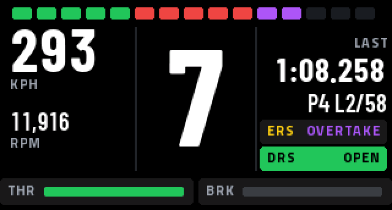

The ESP32 dashboard is a small race dash that sits on the rig and shows the driver's live data from the collector. It is optional: the collector, the dashboards and the event run the same without it.


This section describes what the dashboard does. To install it on a board, follow the [esp32-dash guide](https://github.com/splunk/datadrivers-f1-collector/tree/main/esp32-dash) in the collector repository.


## Supported boards

The dashboard runs MicroPython on two Waveshare boards with a 1.47-inch, 320×172 colour screen:

- **ESP32-C5-LCD-1.47**
- **ESP32-S3-LCD-1.47B**, which also turns the picture the right way up when the board is turned over.

Both boards have a **BOOT** button, which switches between the race dash and the lap timing view, and an RGB LED that repeats the most important colour on the screen.

## How the collector sends to it

Each rig can send to one dash. In the collector, set the rig's **Dash screen** to the address the board shows while it waits for data, for example `192.168.1.50:20788`, and choose a **Dash rate** (10 Hz by default). See [Optional rig dash screen](/f1-2025/controller-config/#optional-rig-dash-screen).

The collector sends one small UDP packet per update to that address while the rig is racing, and keeps sending the result once the race ends. The board doesn't reply, so a dash that is switched off or out of range does not affect the collector. The collector must be able to reach the board over the network; a DHCP reservation keeps the board's address the same.

## In this section





