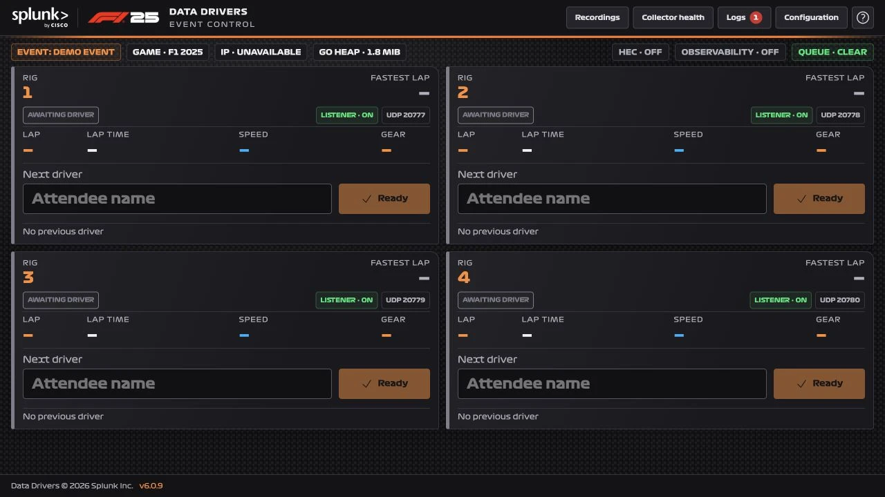

These guides cover the **v6 F1 2025 collector**. Connect up to four independent rigs and send race data to Splunk Enterprise/Cloud through , Splunk Observability Cloud, or both.

The collector sends the attendee’s race data to your configured destinations. Select **Ready** before the starting lights, then leave the game running through the results screen until the collector saves the result. If a destination is unavailable, unsent data waits in a queue for delivery.

## Choose your setup




1. Open `http://<your-show-host>.splunk.show:81` and confirm the footer shows v6.
2. Check **Configuration → Event** and **Rigs**.
3. Keep provisioned HEC settings unless your administrator directs otherwise. Add your Observability realm/token if needed.
4. Save changes and test each saved destination.
5. Follow [Game Telemetry Setup](/f1-2025/telemetry/) for each rig.
6. Enter a driver name and select **Ready** before starting the race.




1. Follow [Docker Setup](/f1-2025/docker-setup/), including a persistent `/data` volume.
2. Open `http://localhost:81` or `http://localhost:8501`.
3. Configure the event, rigs and at least one destination.
4. Follow [Game Telemetry Setup](/f1-2025/telemetry/), using the Docker host's LAN IP for a separate simulator.
5. Enter a driver name and select **Ready** before starting the race.




## Event workflow

Use the [Event Guide](/event_guide/) to prepare the game. For each attendee, enter their name on the correct rig and select **Ready** before starting the race. Leave the game on the results screen until the collector saves the result and opens the card for the next driver. Each rig operates independently.

The collector starts its listeners automatically. Optional [recording and playback](/f1-2025/managing-collectors/#recording-telemetry) are available from **Recordings**.

## Test before guests arrive

Run a full three-lap race on each rig, including the results screen, and verify each enabled destination’s dashboard. Check that its queue clears. See the [pre-event checklist](/f1-2025/monitoring/#pre-event-checklist).

## Next steps










## Deployment and automation

Use the [Docker instructions](/f1-2025/docker-setup/#persistent-files) for persistent storage and the [HEC update API](/f1-2025/controller-config/#automation) for provisioning. See [Display Screens](/f1-2025/pit-wall/) for spectator dashboards.
